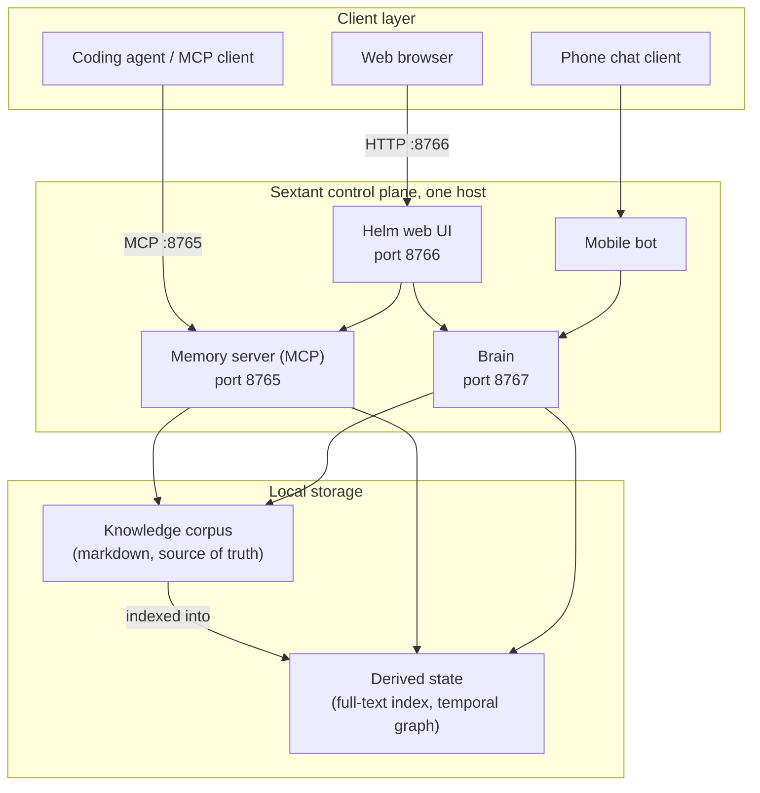
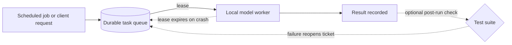

# Sextant Architecture

Last updated: 2026-07-28

This document is for a technical evaluator deciding whether to trust Sextant
with their own LLM memory. It describes the control plane, the memory model,
the scheduler and worker, and how the pieces compose. For hands-on setup see
the project README and the deeper docs under `docs/`.

Sextant is a self-hosted memory and orchestration platform for your own daily
LLM sessions. It runs entirely on your machine. There is no cloud dependency
and no per-seat pricing. The design goal is simple: every session should begin
with the context of every prior session, without manual priming.

## Design principles

Three principles govern every component below.

- **Markdown is the source of truth.** The knowledge corpus is plain markdown
  files you can read, edit, and version yourself. Every derived structure (the
  full-text index, the temporal knowledge graph) is rebuildable from those
  files. If a derived store is lost or corrupted, it is regenerated; nothing
  authoritative is lost.
- **Fail closed.** Every network surface requires authentication. Services bind
  to loopback by default. A single kill switch gates every write path, so the
  system can be dropped to read-only in one move.
- **Version before edit.** Every write to the corpus snapshots the prior state
  first, so history is recoverable and no edit is silently destructive.

## The control plane

Sextant exposes three local services plus one mobile channel. Each has a fixed
port and a distinct trust level.

| Service | Port | Role | Exposure |
|---------|------|------|----------|
| Memory server (MCP) | 8765 | Read and write the knowledge corpus over the Model Context Protocol | Loopback by default; may be published through an authenticated tunnel |
| Brain | 8767 | Task queue, local model workers, scheduled jobs | Loopback only, never published (it can execute tools) |
| Helm web UI | 8766 | Human dashboard over the whole system, including the live system Map | Loopback only |
| Mobile bot | n/a | Full control from a phone chat client | Long-poll to a chat provider, no inbound port |

### Memory server (MCP, port 8765)

The memory server is the primary entry point. It speaks the Model Context
Protocol, so any MCP-aware client (a coding agent, an editor, a custom script)
can query and update memory through a stable tool interface. It exposes a
family of tools covering memory read and write, full-text search over the
corpus, the temporal knowledge graph, tickets, and project state.

Full-text search is backed by an SQLite FTS index built from the markdown
corpus. Because the index is derived, it can be rebuilt at any time from the
authoritative files.

The server binds to loopback by default. When remote access is wanted, it is
reached through an authenticated tunnel rather than by opening a raw inbound
port, and every request still carries a token. Auth is mandatory on this
surface.

### Brain (port 8767)

Brain is the orchestration engine: a local service that runs a durable task
queue and dispatches work to model workers running on the same machine. It is
the only component that can execute tools and drive multi-step work on its own,
which is why it is bound to loopback and never published, even when the memory
server is reachable remotely.

Brain owns the scheduler and the worker pool described below. The web UI and
the mobile bot are thin clients in front of it.

### Helm web UI (port 8766)

Helm is the human dashboard. It is a server-rendered web interface (progressive
HTML with server-sent events for live updates) that surfaces the whole system
in one place: system health, the task queue, memory browsing and search,
tickets, sessions, and a chat view onto Brain. Helm holds no authoritative
state of its own; it reads and writes through the memory server and Brain. It
binds to loopback and requires a session or API key.

### Mobile bot

The mobile bot gives full control of the system from a phone chat client. It
connects outbound to a chat provider by long-polling, so it needs no inbound
port. It is a reactive command surface in front of Brain; proactive
notifications are delivered through a separate push channel.

## The memory model

Memory is layered so that the authoritative store stays human-readable and
everything expensive to compute is treated as a cache.

- **Corpus (authoritative).** A tree of markdown files, organized by kind
  (identity, preferences and corrections, reference material, per-project
  state, runbooks, and dated session logs). You can open any of it in a text
  editor. This is what you own and what you back up.
- **Derived state (rebuildable).** The full-text search index and the temporal
  knowledge graph. Both are generated from the corpus and can be discarded and
  rebuilt without loss.

The paths are configured by environment variable, with home-relative defaults:
one root for the corpus, one for derived state, and a chronological log file.
Nothing is hard-coded to a specific machine.

### Version before edit

Every write to the corpus first snapshots the previous version of the affected
file. Edits are therefore always recoverable, and an automated or model-driven
write can never silently overwrite prior context.

### Staleness and reverification

A fact that was true when written can quietly become false. Sextant treats this
as a first-class problem. The temporal knowledge graph tracks facts over time,
detects decay (facts that are aging or contradicted), and a scheduled
re-verification pass re-checks overdue facts with a local model and reports
each one as still valid, outdated, or needing a human -- so confidently-wrong
memory is surfaced rather than trusted forever. (The pass reports by default;
letting it reset decay clocks on its own is a separate opt-in switch.) This
staleness loop is the part of the design aimed squarely at the failure mode
that makes long-lived agent memory untrustworthy.

## The scheduler and worker

Brain turns intentions into completed work through a durable queue and a pool
of local workers.

- **Durable task queue.** Tasks are persisted, so work survives a restart. A
  task is not lost because a process died mid-run.
- **Worker leases.** A worker claims a task under a lease before running it. If
  a worker dies, its lease expires and the task becomes available again instead
  of being stranded.
- **Retries.** Failed tasks are retried under policy rather than dropped.
- **Optional post-run verification.** With `ATLAS_VERIFY_TICKETS=on` (off by
  default), completing a ticket task queues a follow-up run of the project's
  test suite; a failure reopens the ticket instead of leaving bad work marked
  done. It is a post-run check, not a gate in front of results.

### Scheduled memory hygiene

On a schedule, Brain runs the maintenance jobs that keep memory healthy without
a human in the loop:

- proposing durable facts distilled from recent sessions, with high-confidence
  proposals written automatically and the rest queued for review,
- periodic consolidation of memory, and
- periodic reflection passes that revisit and reverify existing knowledge.

These jobs are what let the corpus improve on its own between sessions instead
of only when someone remembers to curate it.

## How the pieces compose

A typical loop ties the components together:

1. A session starts. A start hook primes the client with the relevant corpus,
   so the session opens with prior context already loaded.
2. During the session, the client reads and writes memory through the memory
   server on port 8765, and can queue work to Brain.
3. The session ends. A stop hook summarizes the transcript and proposes durable
   memory updates.
4. Between sessions, Brain's scheduled jobs distill facts, consolidate memory,
   and reverify aging knowledge, snapshotting every write.
5. Throughout, Helm on port 8766 and the mobile bot give a human live visibility
   and control, both reading and writing through the same memory server and
   Brain rather than around them.

The result is a closed loop: sessions feed the corpus, the corpus is curated
and reverified between sessions, and the next session starts already primed.

## Security posture, in brief

- Every network surface requires authentication.
- Services bind to loopback by default; only the memory server is ever exposed
  remotely, and only through an authenticated tunnel.
- Brain, which can execute tools, is never published.
- A single kill switch gates every write path, allowing the whole system to be
  dropped to read-only immediately.
- Version-before-edit makes every change recoverable.

For how to report a vulnerability, see `SECURITY.md`. Please do not open public
issues for security reports.

## Where to go next

- Project README: overview, quickstart, and how it compares to hosted memory
  layers.
- `docs/`: deeper architecture notes, usage guides, and the decision records
  that explain why the system is shaped this way.
